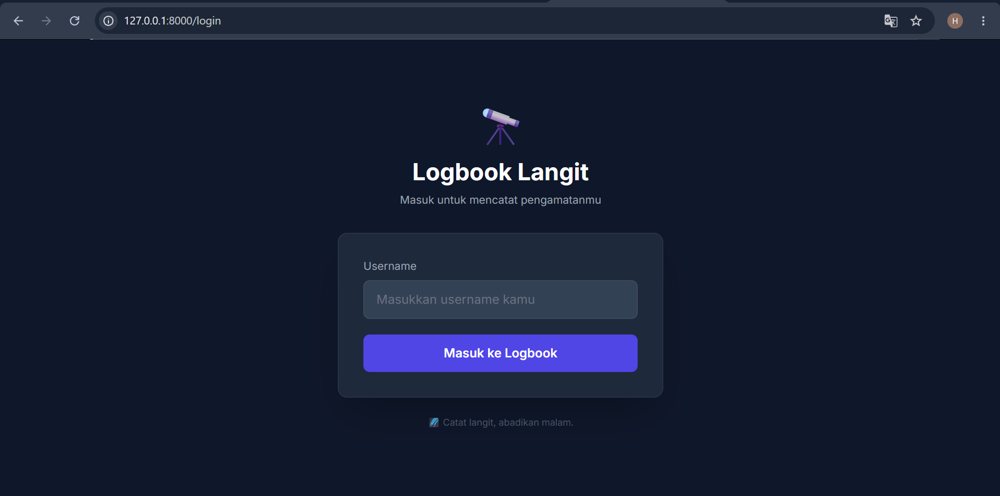
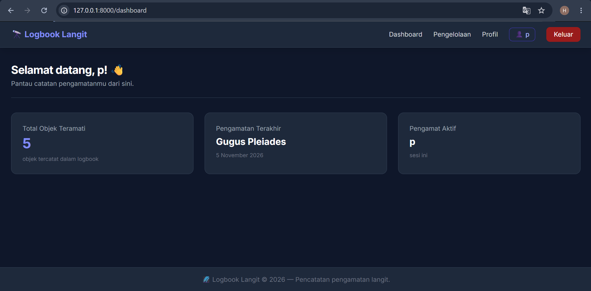
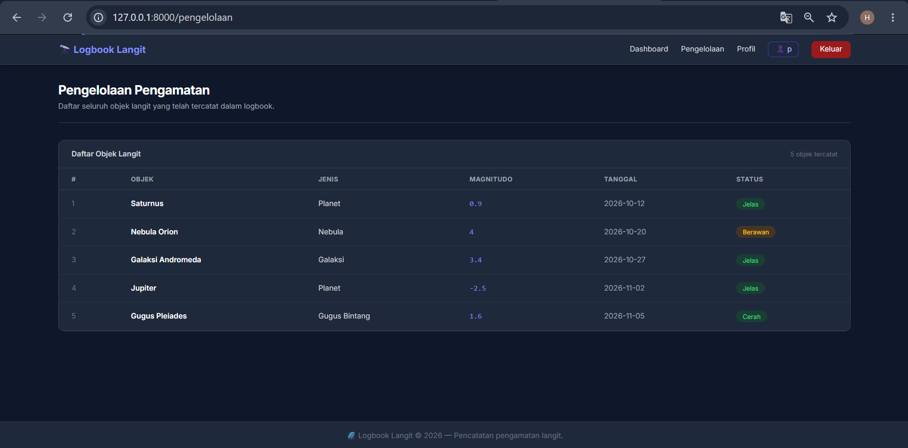

# 🔭 Logbook Langit

Aplikasi web pencatatan digital pengamatan benda langit berbasis **Laravel 11**.
Dibuat sebagai proyek UTS Pemrograman Web Genap 2025/2026.

---

## Deskripsi

Logbook Langit memungkinkan pengamat langit mencatat benda-benda langit yang
pernah diamati — planet, nebula, galaksi, dan gugus bintang — lengkap dengan
tanggal pengamatan, magnitudo, dan status cuaca saat itu.

## Teknologi

- PHP + Laravel 11
- Blade Template Engine
- Tailwind CSS (CDN)
- Session Laravel

## Halaman

| Halaman      | URL            | Fungsi                                      |
|--------------|----------------|---------------------------------------------|
| Login        | `/login`       | Masuk menggunakan username                  |
| Dashboard    | `/dashboard`   | Ringkasan pengamatan, sambutan personal     |
| Pengelolaan  | `/pengelolaan` | Tabel daftar objek langit dengan @foreach   |
| Profil       | `/profile`     | Informasi pengamat aktif                    |

## Screenshot

### Login


### Dashboard


### Pengelolaan


### Profil


## Cara Menjalankan

```bash
git clone https://github.com/egamaulana1747-dev/UTS_PWEB_252410103089.git
cd UTS_PWEB_252410103089
composer install
cp .env.example .env
php artisan key:generate
php artisan serve
```

Buka `http://127.0.0.1:8000`

---

**Nama:** EGA MAULANA FADHILAH  
**NIM:** 252410103089  
**Kelas:** B  
**Mata Kuliah:** Pemrograman Web